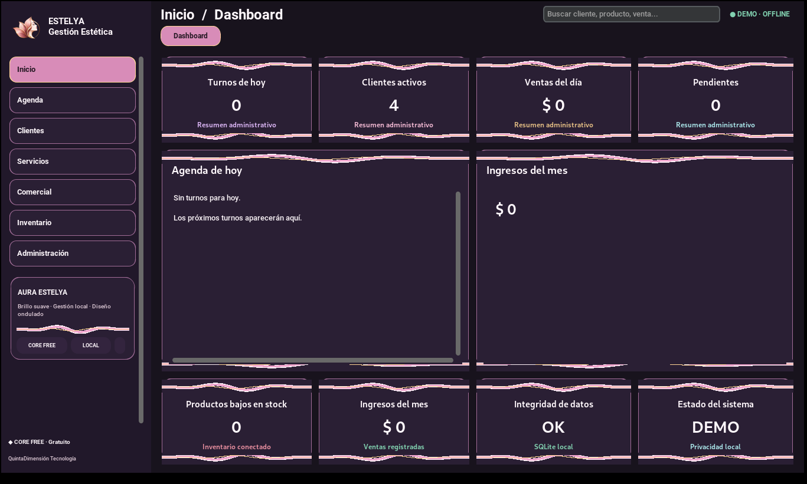
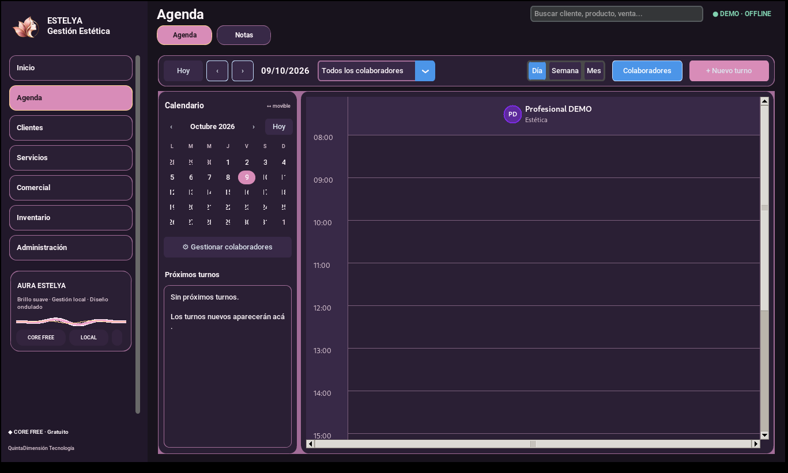
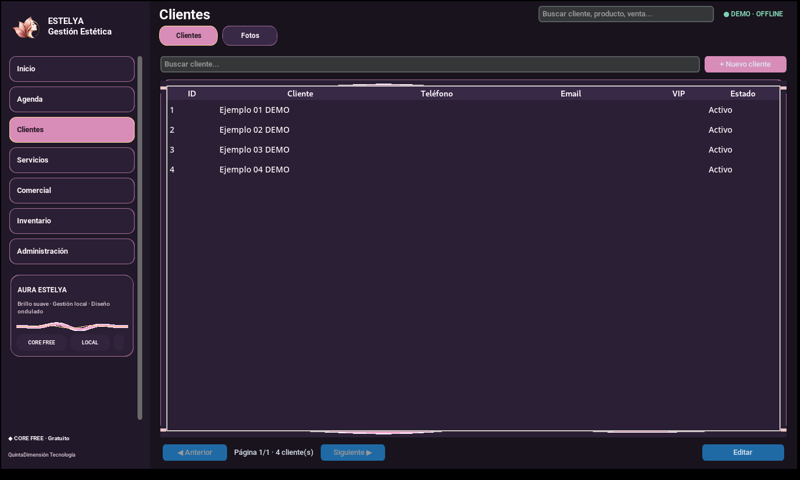
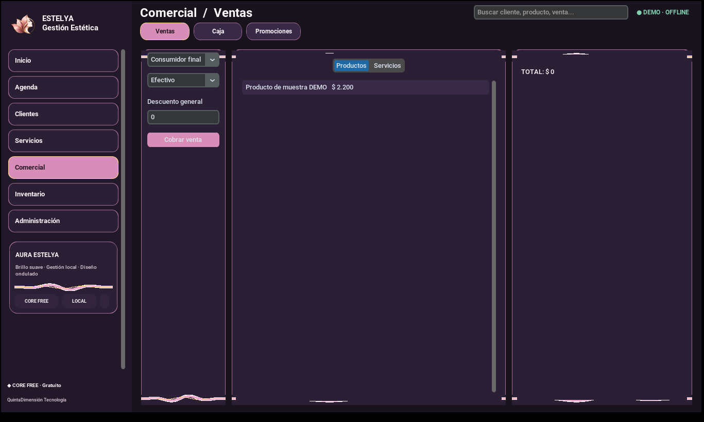
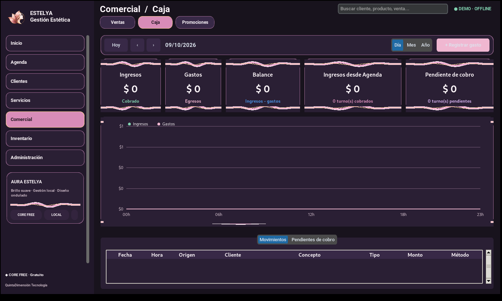
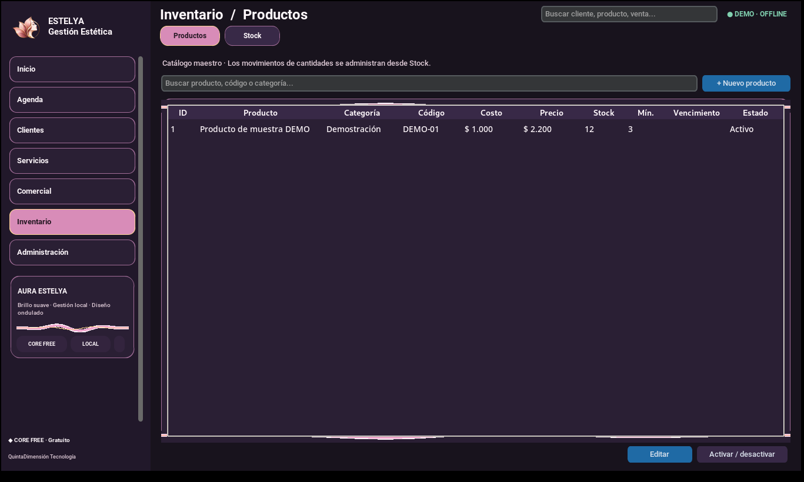
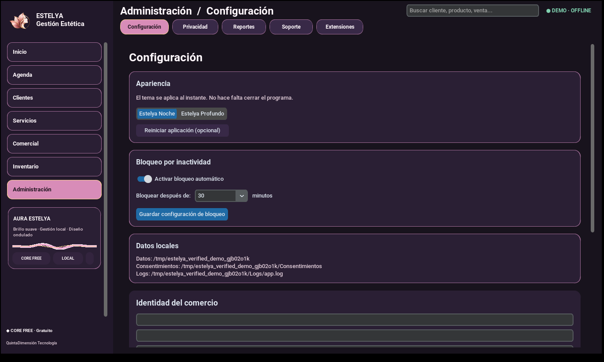

# ESTELYA · Gestión Estética

**Software de escritorio para comercios de estética · CORE FREE · v2.0.0-rc.3.2 (candidata)**

**QuintaDimensión Tecnología** presenta ESTELYA, una aplicación administrativa local-first dirigida a centros de estética, peluquerías, spas y servicios personales. El objetivo comercial es ofrecer el núcleo de gestión gratuitamente y comercializar solamente futuras extensiones opcionales.

> **Aviso:** Esta es una presentación técnica del portfolio, no un instalador ni software validado para tratar datos clínicos reales. Las condiciones de uso gratuito y la denominación comercial requieren revisión definitiva antes de distribuir a comercios.

## Pantallas del programa (capturas reales del modo DEMO)

Estas capturas provienen de ESTELYA ejecutada con **datos ficticios** en una interfaz virtual Linux. No son diseños conceptuales ni acreditan compatibilidad final con Windows.

### Dashboard

### Agenda

### Clientes

### Ventas y Caja

### Inventario

### Configuración

## Áreas de gestión

| Área | Capacidades presentes |
|---|---|
| Inicio | Indicadores del negocio y resumen de agenda |
| Agenda | Turnos y notas administrativas |
| Clientes | Fichas y fotografías |
| Servicios | Tratamientos y consentimientos |
| Comercial | Ventas, caja y promociones |
| Inventario | Productos, existencias y movimientos |
| Administración | Reportes, privacidad y pantallas locales de soporte/extensiones |

## Tecnologías

Python, Tkinter/CustomTkinter, SQLite, Pillow, `cryptography`, Argon2id, ReportLab y python-docx. PyInstaller e Inno Setup son parte de la preparación de distribución Windows.

## 💻 Ingeniería de software — Ejemplos de código

ESTELYA también presenta una selección de código Python real para facilitar la evaluación técnica del proyecto.

Los ejemplos permiten revisar decisiones de ingeniería sin necesidad de acceder al código fuente propietario completo.

**Contenido disponible:**

- **Arquitectura y navegación modular:** organización de siete áreas administrativas y sus pantallas.
- **Pruebas de regresión:** validación de la estructura de navegación mediante pruebas automatizadas.
- **SQLite y datos de demostración:** preparación de registros ficticios para un entorno de evaluación aislado.

📂 **[Consultar ejemplos de código — CODE_SAMPLES.md](CODE_SAMPLES.md)**

**Alcance:** los fragmentos corresponden a ESTELYA v2.0.0-rc.3.2 y se publican exclusivamente para revisión técnica del portfolio. No constituyen la aplicación completa ni una certificación de seguridad.

El código fuente integral se mantiene privado.

## Privacidad, alcance y límites

- Opera sobre base SQLite local.
- Modo DEMO efímero aislado de datos reales.
- Cifrado selectivo; no protege automáticamente todos los adjuntos.
- Sin telemetría remota por defecto; no existe backend comercial de gadgets.
- Estado RC: pruebas automatizadas y GUI virtual aprobadas; pruebas Windows del instalador pendientes.
- El ejecutable de demostración para Windows se distribuye mediante GitHub Releases. El código fuente propietario completo permanece privado. No existe todavía un instalador comercial validado.

## Distribución y derechos

El proyecto se proyecta como **software gratuito de uso** para comercios, con futuras herramientas opcionales de pago. La visibilidad del portfolio no concede licencia de reutilización del código ni convierte al proyecto en open source. Consultar [estado legal y borrador](LICENSE_TERMS_DRAFT.md) y [copyright](COPYRIGHT.md).

## 🌸 Descargar ESTELYA DEMO — Windows x64

**ESTELYA CORE FREE v2.0.0-rc.3.2 — Versión candidata de demostración**

Conocé ESTELYA, una aplicación administrativa para centros de estética, peluquerías, spas y comercios de belleza.

**[⬇️ Descargar ESTELYA DEMO para Windows](https://github.com/carlos-adrian-ledesma/estelya-gestion-estetica/releases/download/v2.0.0-rc.3.2/ESTELYA_DEMO_Windows_x64_v2.0.0-rc.3.2.zip)**

### Cómo utilizarlo

1. Descargá `ESTELYA_DEMO_Windows_x64_v2.0.0-rc.3.2.zip`.
2. Extraé completamente el contenido en una carpeta de tu computadora.
3. Abrí la carpeta generada al descomprimir.
4. Ejecutá `ESTELYA_DEMO.exe` sin moverlo fuera de su carpeta.
5. Explorá la aplicación con datos ficticios.

**Requisitos:** Windows x64 compatible. No es necesario instalar Python.

**Importante:** ESTELYA DEMO es una versión preliminar de evaluación. No utilizar con datos reales de clientes o pacientes.

**Características:** demostración gratuita, funcionamiento local, sin contraseña de prueba compartida y sin necesidad de instalar Python.

**Estado:** Pre-release. El programa continúa en evaluación y no debe utilizarse para administrar datos personales o clínicos reales.

[Consultar versiones y notas de publicación](https://github.com/carlos-adrian-ledesma/estelya-gestion-estetica/releases)

[Verificar integridad SHA-256](https://github.com/carlos-adrian-ledesma/estelya-gestion-estetica/releases/download/v2.0.0-rc.3.2/ESTELYA_DEMO_Windows_x64_v2.0.0-rc.3.2.zip.sha256.txt)

## Desarrollo y próximos pasos

Consultar [arquitectura](ARCHITECTURE.md), [privacidad](PRIVACY.md), [roadmap](ROADMAP.md) y [avisos de terceros](THIRD_PARTY_NOTICES.md).

**© 2026 QuintaDimensión Tecnología. Todos los derechos reservados.**
